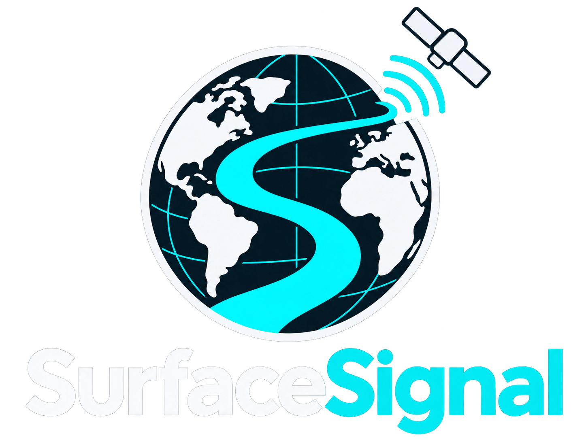

<div align="center">

<p align="center">
  <a href="https://sudonova.surfacesignal.earth/"></a>
  &nbsp;&nbsp;&nbsp;&nbsp;
  <a href="https://surfacesignal.earth/"></a>
</p>

<h1>SurfaceSignal</h1>

<p><strong>Tornando as mudanças da Terra compreensíveis</strong></p>
<p>Explorando mudanças ambientais com radar de satélite e contexto científico.</p>
<p><strong>NASA Space Apps Challenge 2026 · Dancing with the SARs · Sudo Nova</strong></p>

<p><a href="./README.md">English</a> · <strong>Português</strong></p>

<p>
  <a href="https://surfacesignal.earth/"></a>
  <a href="https://github.com/sudo-nova-nsac26/presentation/blob/main/Surface%20Signal%20-%20Presentation.pdf"></a>
</p>

<p><a href="https://surfacesignal.earth/">Aplicação publicada</a> · <a href="https://github.com/sudo-nova-nsac26/presentation/blob/main/Surface%20Signal%20-%20Presentation.pdf">Apresentação (PDF)</a> · <a href="https://sudonova.surfacesignal.earth/">Portfólio da equipe</a> · <a href="https://www.spaceappschallenge.org/2026/find-a-team/sudo-nova/?tab=project">Inscrição Space Apps</a></p>

</div>

---
## Observação da Terra com dados reais

O **[SurfaceSignal](https://surfacesignal.earth)** é uma aplicação bilíngue da Sudo Nova para o desafio **Dancing with the SARs** do NASA Space Apps Challenge 2026. No piloto de **Lajeado, Estrela e Vale do Taquari (RS)**, foram processadas **19 aquisições NISAR L2 GCOV** (aproximadamente **131,39 GB** de HDF5) e produzidas **17 comparações históricas**, contextualizadas por dados ambientais de fontes públicas.

As mudanças no sinal de radar são **candidatos exploratórios**, não inundações, danos ou riscos confirmados. O projeto **não** é um sistema de alerta ou previsão de desastres.

## Como executar — com ou sem API

| | Estático (padrão) | Com FastAPI (opcional) |
|---|---|---|
| Uso | Visitar, desenvolver o frontend e publicar no Cloudflare Pages | Testar endpoints, integrar clientes e consultar resultados científicos locais |
| Fonte de dados | Snapshot real em `frontend/public/data/compact/api/v1/` | FastAPI `/api/v1/`, lendo dados preparados ou o snapshot |
| Precisa baixar 131 GB? | **Não** | **Não** |
| Precisa Python/credenciais? | **Não** | **Python 3.12 ou Docker; sem Earthdata para dados preparados** |

**Opção 1 — frontend estático:**

```sh
git clone https://github.com/sudo-nova-nsac26/surface_signal.git
cd surface_signal/frontend
npm ci
npm run dev
```

Use **Node.js 24**, como definido em `frontend/.node-version`. Abra **http://localhost:3000/** e selecione `/pt/` ou `/en/`. Para gerar e verificar a exportação estática:

```sh
npm test
npm run lint
npm run build
npm run check:static
npm start
```

A saída é `frontend/out/`. O snapshot inclui as 19 cenas e 17 comparações, mas **polígonos simplificados são apenas para visualização**, não devem ser usados para recalcular áreas. O mapa-base/relevo precisa de conexão para carregar tiles.

**Opção 2 — backend somente leitura:**

Na raiz, com Python 3.12 e [uv](https://docs.astral.sh/uv/):

```sh
uv sync --project backend --frozen --extra dev
uv run --project backend --frozen uvicorn surfacesignal.main:app --host 127.0.0.1 --port 8000
```

Ou com Docker:

```sh
mkdir -p data artifacts
docker compose up --build
```

Teste `http://127.0.0.1:8000/health`, `http://127.0.0.1:8000/api/v1/analyses` e a documentação em **http://127.0.0.1:8000/docs**.

Copie `frontend/.env.example` para `frontend/.env.local` e configure:

```dotenv
NEXT_PUBLIC_API_BASE_URL=http://127.0.0.1:8000
```

A configuração CORS, se necessária, fica no `.env` da raiz:

```dotenv
SURFACESIGNAL_CORS_ORIGINS=["http://localhost:3000","http://127.0.0.1:3000"]
```

Reinicie o frontend. Remova `NEXT_PUBLIC_API_BASE_URL` para retornar ao modo estático. **Não use `localhost` no deploy público:** variáveis `NEXT_PUBLIC_*` aparecem no JavaScript do navegador e nunca devem carregar senhas.

A API não baixa dados NASA nem processa HDF5 em solicitações HTTP. Ela disponibiliza relatórios já preparados, com fallback para o snapshot compacto quando os dados originais não existem.

## Fontes e processamento

| Fonte usada | Contexto e limitações |
|---|---|
| **NISAR L2 GCOV / ASF** | 19 aquisições e 17 comparações de radar; resultados provisórios e não validados em campo |
| **CHIRPS v3 final SAT** | 57 recortes diários de precipitação estimada, não pluviômetros |
| **JRC Global Surface Water v1.5** | Ocorrência histórica de água **1984–2024**, não área alagada em 2026 |
| **ESA WorldCover v200** | Cobertura da terra de **2021** em 10 m |
| **Copernicus DEM GLO-30** | Modelo digital de superfície (inclui prédios e vegetação), não movimentação de terreno |
| **IBGE** | Malhas municipais **2022**, sem cálculo de população afetada |
| **SGB / SACE Taquari** | Boletins hidrológicos qualitativos datados, sem inventar medições numéricas |

IMERG como produto separado, ANA em tempo real, MapBiomas/GEE, Sentinel/OPERA, RCM e Open-Meteo **não foram ingeridos** no piloto publicado.

O processamento: checagem de compatibilidade de aquisições GCOV, leitura limitada à área piloto, máscaras de validade/looks, alinhamento, `10 log10` da potência gamma0 diagonal, `ΔdB = depois − antes`, limiares heurísticos e componentes conexos. Aumentos e reduções gerais de sinal não são classificados automaticamente como impactos ambientais. As 17 análises têm rastreabilidade de dados e execução, **não validação independente de inundação**.

Leia [fontes e licenças](docs/data-sources.md), [método científico](docs/scientific-method.md), [evidências das fontes ambientais](docs/public-source-evidence.md), [execução NISAR](docs/real-data-execution.md) e [limitações](docs/limitations.md).

## Baixar e processar novos HDF5 — opcional

**Não é necessário para usar a aplicação.** Para novos processamentos, requer Python 3.12, uv, acesso autorizado ao Earthdata/ASF e bastante armazenamento (~180 GB recomendados para a série).

```sh
uv sync --project backend --frozen --extra dev
uv run --project backend --frozen surfacesignal --root "$PWD" history run \
  --snapshot docs/evidence/asf-catalog.json \
  --hydro-csv config/hydrology/sgb-2026-07-23.csv --dry-run
```

Configure localmente `~/.netrc` com permissão `0600` ou `SURFACESIGNAL_EARTHDATA_TOKEN` (o alias `EARTHDATA_TOKEN` também funciona) para executar sem `--dry-run`. Nunca comite credenciais. Veja [operações](docs/backend-operations.md), [reprodutibilidade](docs/reproducibility.md) e [distribuição de snapshots](docs/snapshot-delivery.md).

## Estrutura

```text
frontend/              Next.js 16, React, MapLibre, site acessível PT/EN
  src/data/source.ts   único adaptador API/estático
  public/data/compact  resultados processados versionados
backend/               Python 3.12, FastAPI de leitura, CLI científico
config/                área piloto e exemplos de fontes
docs/                  métodos, operação, fontes, evidências, publicação
assets/                logos Sudo Nova e SurfaceSignal
```

O site oficial **[surfacesignal.earth](https://surfacesignal.earth)** estático é publicado via Cloudflare Pages, sem precisar de API em produção. Consulte o [índice de documentação](docs/README.md), [arquitetura](docs/architecture.md), [API](docs/api-contract.md) e [publicação](docs/cloudflare-pages.md).

## Equipe, licença e segurança

**Arthur Henrique Fassina**, **Mateus Carniel Brambilla** e **Yuri Korolko** · [Portfólio da equipe](https://sudonova.surfacesignal.earth) · [Apresentação](https://github.com/sudo-nova-nsac26/presentation/blob/main/Surface%20Signal%20-%20Presentation.pdf) · [Inscrição oficial](https://www.spaceappschallenge.org/2026/find-a-team/sudo-nova/?tab=project).

Código e documentação originais do projeto sob **[Apache License 2.0](LICENSE)** (`Apache-2.0`). Dados científicos, imagens, mapas, bibliotecas, fontes tipográficas e materiais de terceiros conservam seus termos; consulte [NOTICE](NOTICE) e [fontes](docs/data-sources.md). Consulte [SECURITY.md](SECURITY.md) para vulnerabilidades. Trabalhos exploratórios anteriores e dúvidas de elegibilidade permanecem documentados em [proveniência](docs/prototype-provenance.md); não há declaração de autorização oficial.

<div align="center"><sub>Projeto independente Sudo Nova · Brasil · 2026 · Sem vínculo oficial com NASA ou ISRO.</sub></div>
